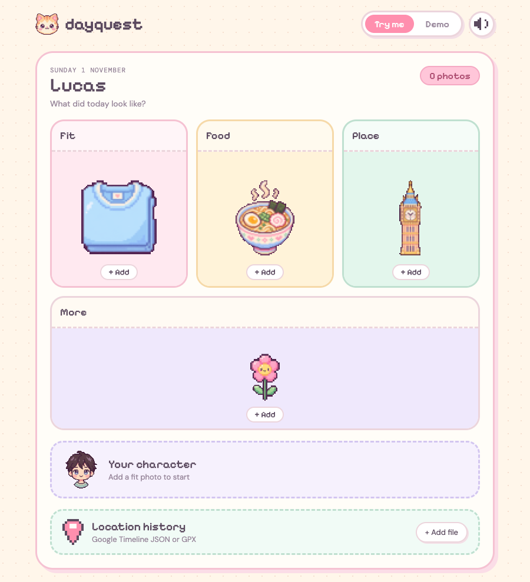
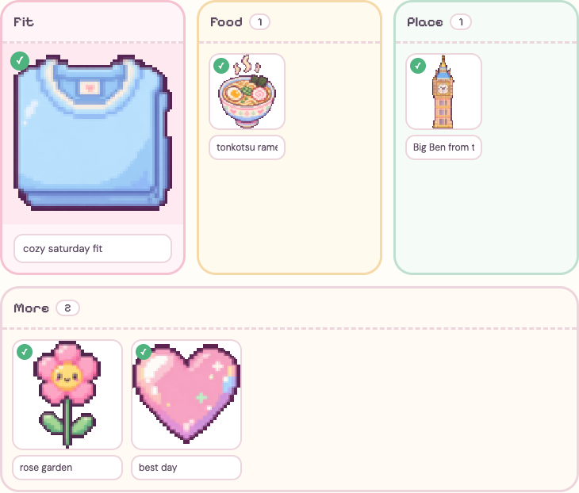
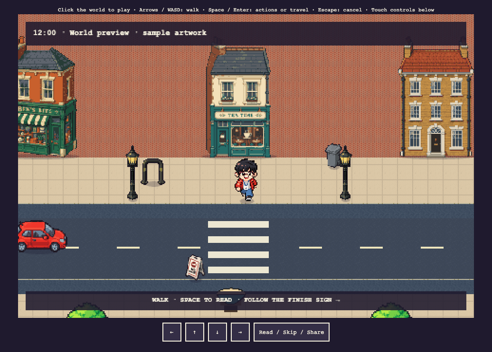
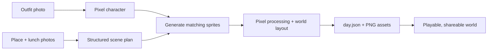

<div align="center">

<h1>✦ DayQuest</h1>

<p><strong>A day worth visiting.</strong></p>

<p>Turn the places you went, the things you ate, and the outfit you wore<br />into a little pixel world for someone you love to explore.</p>

<p><strong>🎮 Live demo: <a href="https://dayquest-pi.vercel.app/">dayquest-pi.vercel.app ↗</a></strong></p>
<p><a href="https://dayquest-pi.vercel.app/demo">View a sample day</a></p>

<p>
  <a href="#why-dayquest">Why we built it</a> ·
  <a href="#the-experience">The experience</a> ·
  <a href="#how-we-built-it">How it works</a> ·
  <a href="#run-it-locally">Run locally</a>
</p>



<p><sub>The updated Try me screen: a little home for the things that made your day.</sub></p>

</div>

## Why DayQuest?

“How was your day?” is a small question with a lot behind it. For long-distance partners, a few messages and photos can leave out the feeling of being there: the street you wandered down, the little lunch spot, the ordinary moments you would have shared.

**DayQuest makes those moments a place you can visit.** Upload your outfit, a place, and your lunch; turn them into a personal pixel neighbourhood; then send a link. Someone you love can walk your character around, explore the scenery, and discover the details of your day at their own pace.

The idea began as a four-hour OpenAI hackathon project: make everyday life feel a little more present, even from far away.

## The experience

<table>
  <tr>
    <td width="50%" valign="top"></td>
    <td width="50%" valign="top"></td>
  </tr>
  <tr>
    <td><strong>01 / Your day, in little pieces</strong><br />Photo galleries and short notes. This example comes from the Demo tab.</td>
    <td><strong>02 / A place to visit</strong><br />Walk, discover and share. The world shown here uses offline sample artwork.</td>
  </tr>
</table>

1. **Start with your fit.** Open **Try me** and add a full-body front photo to generate your pixel character. Preview it before setting off.
2. **Collect the details.** Add photos to **Food**, **Place** and **More**, with a short note for each. Pick several at once, drag them in, or use the camera button on your phone. The first Place and Food photos guide the scenery and meal.
3. **Create your world.** Follow the generation log as the scene takes shape. Completed sprites are saved, so a refresh or retry can continue the build.
4. **Invite someone in.** Share the `/day/<id>` link. The viewer opens without an account, with keyboard and touch controls for exploring and interacting.

**Controls:** Arrow keys / WASD to walk · Space / Enter for actions and travel · Escape to cancel. Touch buttons are available below the world.

The **Demo** tab shows a filled example day with sample images, captions, a London route over OpenStreetMap, transport chips and walking stats. Try me also accepts a Google Timeline JSON or GPX file and shows the number of imported location points and their date range. A sound toggle lets you switch the interface's little audio cues on or off.

> **Current scope:** The connected creation flow builds one neighbourhood using your fit and the first Food and Place photo. Additional photos and notes are saved in the draft; location-history imports currently show a local summary and are not passed to generation. The Demo tab's route, journeys and walking stats are sample data. The renderer supports connected locations, travel and saved interactions through the development previews below. All screenshots were captured locally without paid generation calls.

## How we built it

The core is a small pipeline: understand the photos, generate the artwork, then assemble a world the browser can play.



- **The app:** Next.js App Router, React and TypeScript power the responsive pastel interface, multi-photo galleries, captions, character previews and shared-day pages. Larger photos are resized in the browser; uploads are decoded, oriented and stripped of metadata on the server. Drafts survive refreshes in the same browser tab.
- **The scene planner:** OpenAI photo analysis returns a validated inventory of three buildings or scenic elements, props and optional food. The plan distinguishes observed details from supporting scenery and avoids inventing named places or visits.
- **The artwork:** OpenAI image editing uses your photos and a shared pixel-art style to create transparent building sprites, food, custom props and a directional walking sheet. Sharp fits the results to game dimensions and preserves crisp pixels. Shared ground textures and street furniture fill out the scene.
- **The game:** A custom Canvas 2D renderer, developed from the repository's Shadwell prototype, handles sprite depth, collision, movement, dialogue and interactions. It loads a validated `day.json` manifest and PNGs; playing a published world requires no model calls.
- **The build jobs:** Generation advances through checkpointed steps, with up to three independent sprite requests at once. Each successful asset is saved separately, so retries reuse completed work. Vercel Blob stores published worlds in production; local development can use the filesystem.

Interactions are composed from validated instructions, generic effects and the scene's own generated assets. Your character, meal and photographed subjects keep their generated artwork during interactions. Connected itineraries add boarding points and bus, Tube or walking transitions. Browser-local progress lets a visitor return to the same published world.

## Run it locally

Use **Node.js 22+** and npm; CI uses Node 26.

```bash
git clone https://github.com/w3joe/dayquest.git
cd dayquest
npm ci
cp .env.example .env.local
npm run dev
```

Open [localhost:3000](http://localhost:3000) for **Try me**, or [/demo](http://localhost:3000/demo) for the filled example. Browsing the interface, demo and offline previews requires no API credentials; creating your character or world does.

### Explore a sample world

With the development server running, run this in another terminal:

```bash
npx tsx scripts/preview-world.mts
```

Visit [the world preview](http://localhost:3000/day/world-preview). It reuses bundled sample artwork and makes no paid API calls.

| Preview | Generate the fixture | Open locally |
| --- | --- | --- |
| Connected places and transport | `npm run preview:transport` | [/day/transport-preview](http://localhost:3000/day/transport-preview) |
| Item actions and saved outcomes | `npm run preview:interactions` | [/day/interaction-preview](http://localhost:3000/day/interaction-preview) |

These are development fixtures, separate from the frontend's `/demo` tab. The old playable `/day/demo` route is retired.

### Generate from your own photos

Set `OPENAI_API_KEY` in `.env.local`, with API credits and access to the configured models. Restart the server after changing environment variables.

| Variable | Purpose |
| --- | --- |
| `OPENAI_API_KEY` | Required for character, scene and artwork generation. Keep it server-side. |
| `OPENAI_TEXT_MODEL` | Scene and interaction planning; defaults to `gpt-5.4-mini`. |
| `OPENAI_IMAGE_MODEL` | Character and sprite generation; defaults to `gpt-image-2.5-flare`. |
| `BLOB_READ_WRITE_TOKEN` | Public Vercel Blob storage; required in production. |
| `BLOB_BASE_URL` | The same store's public base URL; required in production. |

Choose JPEG, PNG or WebP photos. Larger images are compressed before upload; each uploaded file must fit within **4 MB**. Food, Place and More support up to 12 photos each, with a 30-photo limit in the shared draft, and notes up to 140 characters. Fit stays a single photo.

Start at `/`, add your fit, wait for the character preview, then choose **Create my world**. Without Blob configuration, development stores uploads and checkpoints in ignored `.data/` and worlds in ignored `public/days/<id>/` folders.

The main flow uses `/api/world-jobs` and makes live model calls. The `PIPELINE_TEXT` and `PIPELINE_IMAGES` switches in `.env.example` apply to the older `/api/generate-day` pipeline. They do not turn the main photo-to-world flow into an offline mode.

### Checks and deployment

```bash
npm run typecheck
npm test
npm run build
```

Development and production builds also prepare the shared game art and validate interaction assets locally.

Pushes to `main` automatically deploy to production through Vercel's GitHub integration once the repository is connected. Other branches do not trigger deployments. See the [deployment guide](docs/DEPLOYMENT.md) for the GitHub connection, environment setup and the optional `npm run deploy:vercel` manual fallback.

## A little further into the code

| Start here | What you'll find |
| --- | --- |
| [`components/today/`](components/today/) | App shell, photo galleries, camera controls, sound, demo and character preview |
| [`app/demo/`](app/demo/) · [`lib/location-history.ts`](lib/location-history.ts) | Sample day and local Google Timeline / GPX parsing |
| [`app/api/world-jobs/`](app/api/world-jobs/) · [`lib/server/world-jobs.ts`](lib/server/world-jobs.ts) | Live generation requests, retries and checkpoints |
| [`pipeline/`](pipeline/) | Photo analysis, sprite jobs, pixel processing and publishing |
| [`game/`](game/) | Canvas renderer, world layout, journeys and interactions |
| [`lib/day.ts`](lib/day.ts) | The shared world manifest and its validation |
| [`docs/TRANSPORT-INTEGRATION.md`](docs/TRANSPORT-INTEGRATION.md) | Connecting scenes and travel legs |
| [`docs/INTERACTION-INTEGRATION.md`](docs/INTERACTION-INTEGRATION.md) | Asset catalogue and contextual actions |
| [`docs/GAME-PROGRESS.md`](docs/GAME-PROGRESS.md) | Saved progress and published revisions |
| [`SPEC.md`](SPEC.md) | Original hackathon concept and design history |

## Credits

The visual style and Canvas rendering approach grew out of the original [`shadwell-25d`](shadwell-25d/) prototype. Shared textures, trees and street furniture reuse its processed artwork; character, landmark and food prompts share its [art direction](shadwell-25d/assets/style.json). The legacy landmark pipeline uses Wikipedia / Wikimedia Commons reference images.

The Demo tab uses OpenStreetMap tiles and attribution. The interface pairs Pixelify Sans, DM Sans and DM Mono with the repository's pixel illustrations.

<div align="center">
  <sub>Made of the little things. ✦</sub>
</div>

## Lucas's London day (no setup)

Open **Demo**, then press **Create my world**. The Demo page is prefilled with real Fit, Food and Place photos (`public/demo/`), the generating screen plays a scripted log, and `/day/demo` opens the hand-built pixel world: Westminster → bus 24 → Kanada-Ya (step inside for table 30) → Central + Bakerloo → Regent's Park. It needs no `.env`, API keys, logins or uploads: `npm install && npm run dev` is enough. The game is the vanilla-canvas engine and scenes copied from `london-25d/` into `public/london-25d/` by `scripts/sync-london-25d.sh`. iPhone HEIC/HEIF photos are converted to JPEG in the browser on every upload path.
